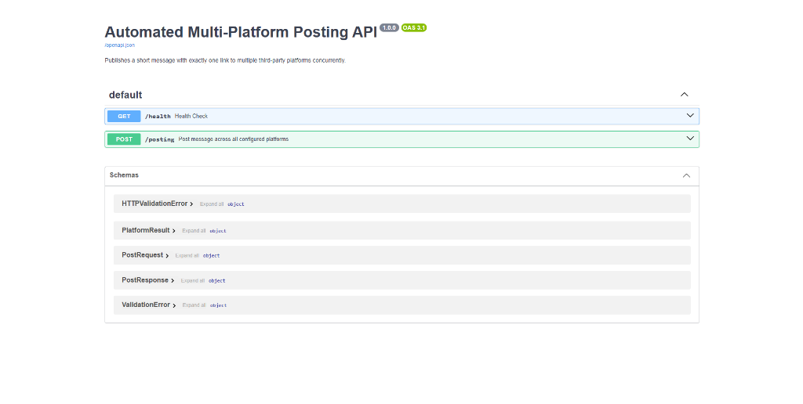
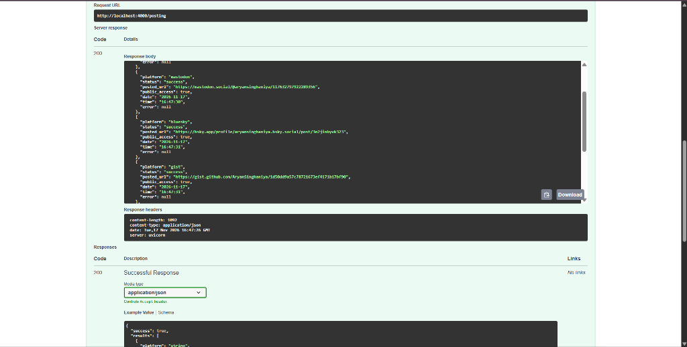
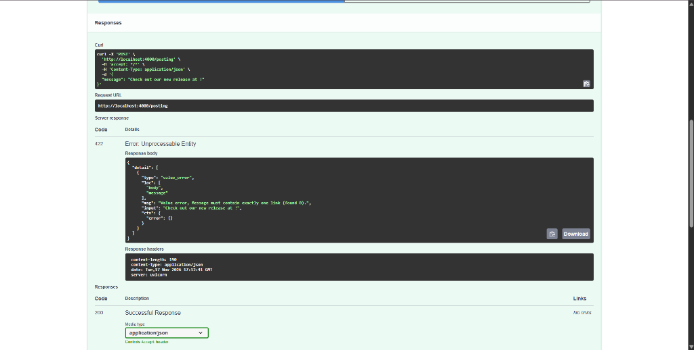

# Automated Multi-Platform Posting API

A FastAPI service that takes one short message containing a call-to-action (CTA) link and publishes it to six third-party platforms at the same time through their official APIs. If one platform fails, the others still post, and the response reports the result for each platform.

**Stack:** Python 3.11+, FastAPI, Uvicorn, Pydantic v2, pydantic-settings, HTTPX (async), pytest, respx

---

## Table of Contents

1. [Features](#features)
2. [Platforms](#platforms)
3. [How It Works](#how-it-works)
4. [Project Structure](#project-structure)
5. [Setup](#setup)
6. [Getting Platform Credentials](#getting-platform-credentials)
7. [Running the Server](#running-the-server)
8. [API Reference](#api-reference)
9. [Sample Requests and Responses](#sample-requests-and-responses)
10. [Running the Tests](#running-the-tests)
11. [Design Decisions](#design-decisions)
12. [Security](#security)
13. [Known Limitations](#known-limitations)
14. [Screenshots](#screenshots)
15. [Live Verified Posts](#live-verified-posts)

---

## Features

- One endpoint: `POST /posting`
- Input validation: maximum 200 characters, exactly one link, and the link must be a valid URL
- Six platforms called concurrently with `asyncio.gather`
- Fault isolation: one platform failing never stops the others
- Per-platform result with status, posted URL, public access, date, time, and error
- Credentials read from environment variables, with no secrets in the repository
- Offline test suite where all external HTTP calls are mocked

---

## Platforms

| # | Platform | API used | Authentication |
|---|----------|----------|----------------|
| 1 | Telegram | Bot API `sendMessage` | Bot token + public channel |
| 2 | Mastodon | `POST /api/v1/statuses` | OAuth Bearer token |
| 3 | Bluesky | AT Protocol `createSession` + `createRecord` | Handle + app password |
| 4 | GitHub Gist | `POST /gists` (public gist) | Personal access token (`gist` scope) |
| 5 | Paste.ee | Paste API | API key |
| 6 | ntfy.sh | HTTP publish to a topic | Topic name |

Each platform is a small class in `app/platforms/`. A platform with missing credentials returns a clear `... not configured` error instead of crashing the request.

---

## How It Works

```
Client
  |  POST /posting {"message": "..."}
  v
Pydantic validation (schemas.py)
  |  length <= 200, exactly one URL, valid URL
  |  invalid input -> HTTP 422
  v
posting_service.post_everywhere()
  |  asyncio.gather runs all platforms concurrently
  v
+----------+----------+---------+--------+----------+--------+
| Telegram | Mastodon | Bluesky |  Gist  | Paste.ee |  ntfy  |
+----------+----------+---------+--------+----------+--------+
  |  each BasePlatform.post() catches its own exceptions
  v
PostResponse { success, results[] }
```

`success` is `true` when at least one platform posted successfully.

---

## Project Structure

```
.
├── app/
│   ├── main.py                  # FastAPI app, routes, logging
│   ├── schemas.py               # Request/response models and validation
│   ├── config.py                # Settings loaded from environment variables
│   ├── platforms/
│   │   ├── base.py              # BasePlatform: timeout, error handling, result building
│   │   ├── telegram.py
│   │   ├── mastodon.py
│   │   ├── bluesky.py
│   │   ├── gist.py
│   │   ├── pasteee.py
│   │   └── ntfy.py
│   └── services/
│       └── posting_service.py   # Runs all platforms concurrently
├── tests/
│   ├── test_validation.py       # Input validation tests
│   └── test_posting.py          # Mocked multi-platform tests
├── screenshots/                 # Images used in this README
├── .env.example
├── .gitignore
├── requirements.txt
└── README.md
```

---

## Setup

**Requirements:** Python 3.11 or higher

```bash
# 1. Clone the repository
git clone https://github.com/AryanSinghaniya/Automated_Posting_plateform.git
cd Automated_Posting_plateform

# 2. Create and activate a virtual environment
python -m venv .venv

# Windows (PowerShell)
.\.venv\Scripts\Activate.ps1
# Linux / macOS
source .venv/bin/activate

# 3. Install dependencies
pip install -r requirements.txt

# 4. Create your environment file
# Windows (PowerShell)
Copy-Item .env.example .env
# Linux / macOS
cp .env.example .env
```

Open `.env` and add your credentials (see the next section). The app starts even if some keys are empty. Any platform without credentials reports a `not configured` error.

---

## Getting Platform Credentials

| Variable | Platform |
|----------|----------|
| `TELEGRAM_BOT_TOKEN`, `TELEGRAM_CHANNEL` | Telegram |
| `MASTODON_BASE_URL`, `MASTODON_TOKEN` | Mastodon |
| `BLUESKY_HANDLE`, `BLUESKY_APP_PASSWORD` | Bluesky |
| `GITHUB_TOKEN` | GitHub Gist |
| `PASTEEE_API_KEY` | Paste.ee |
| `NTFY_TOPIC` | ntfy.sh |

### Telegram

1. Open Telegram and message [@BotFather](https://t.me/BotFather).
2. Send `/newbot`, follow the prompts, and copy the token into `TELEGRAM_BOT_TOKEN`.
3. Create a **public** channel with a username (for example `@mychannel`).
4. Add your bot to the channel as an **Administrator** with permission to post messages.
5. Set `TELEGRAM_CHANNEL=@mychannel`.

The posted URL has the form `https://t.me/<channel>/<message_id>`. It opens publicly only for public channels.

### Mastodon

1. Log in to your instance (for example `https://mastodon.social`).
2. Go to **Preferences → Development → New application**.
3. Select the `write:statuses` scope and submit.
4. Copy **Your access token** into `MASTODON_TOKEN`.
5. Set `MASTODON_BASE_URL` to your instance URL.

### Bluesky

1. Log in at [bsky.app](https://bsky.app).
2. Go to **Settings → Privacy and Security → App Passwords** and create one.
3. Set `BLUESKY_HANDLE` (for example `name.bsky.social`) and `BLUESKY_APP_PASSWORD`.

Use an app password, never your main account password.

### GitHub Gist

1. Go to **GitHub → Settings → Developer settings → Personal access tokens**.
2. Create a token (classic) with only the `gist` scope.
3. Copy it into `GITHUB_TOKEN`.

### Paste.ee

1. Register at [paste.ee](https://paste.ee).
2. Open your account's API page and create an application key.
3. Copy it into `PASTEEE_API_KEY`.

### ntfy.sh

1. Choose a unique topic name, for example `my_unique_topic`.
2. Set `NTFY_TOPIC=my_unique_topic`.
3. View the feed at `https://ntfy.sh/my_unique_topic`.

ntfy topics are public to anyone who knows the name, so do not use a topic name you want to keep private.

---

## Running the Server

```bash
uvicorn app.main:app --host 0.0.0.0 --port 4000
```

Environment variables are read at startup, so restart the server after you edit `.env`.

| URL | Purpose |
|-----|---------|
| http://localhost:4000/docs | Swagger UI |
| http://localhost:4000/redoc | ReDoc |
| http://localhost:4000/health | Health check |

---

## API Reference

### `POST /posting`

**Request body**

```json
{
  "message": "Check out our latest business platform and grow your online visibility. https://example.com"
}
```

**Validation rules**

| Rule | Failure result |
|------|----------------|
| Message must not be empty | 422 |
| Message must be 200 characters or fewer | 422 |
| Message must contain exactly one `http://` or `https://` link | 422 |
| The link must be a valid URL | 422 |

Platform selection is handled internally. The client only sends the message.

**Response fields**

| Field | Description |
|-------|-------------|
| `success` | `true` if at least one platform posted successfully |
| `results[].platform` | Platform name |
| `results[].status` | `success` or `failed` |
| `results[].posted_url` | URL of the published post, or `null` on failure |
| `results[].public_access` | Whether the post is publicly accessible |
| `results[].date` | Posting date (`YYYY-MM-DD`, UTC) |
| `results[].time` | Posting time (`HH:MM:SS`, UTC) |
| `results[].error` | Error details, or `null` on success |

### `GET /health`

Returns `{"status": "ok"}`.

---

## Sample Requests and Responses

### Request

```bash
curl -X POST "http://localhost:4000/posting" \
  -H "Content-Type: application/json" \
  -d '{"message": "Check out our latest business platform and grow your online visibility. https://example.com"}'
```

On Windows PowerShell, use `curl.exe` and save the JSON body to a file:

```powershell
curl.exe -X POST http://localhost:4000/posting -H "Content-Type: application/json" -d "@body.json"
```

### Success response (HTTP 200)

```json
{
  "success": true,
  "results": [
    {
      "platform": "telegram",
      "status": "success",
      "posted_url": "https://t.me/aryan_update/13",
      "public_access": true,
      "date": "2026-11-17",
      "time": "07:40:15",
      "error": null
    },
    {
      "platform": "mastodon",
      "status": "success",
      "posted_url": "https://mastodon.social/@aryansinghaniya/117630646176658188",
      "public_access": true,
      "date": "2026-11-17",
      "time": "07:40:15",
      "error": null
    }
  ]
}
```

The full response contains one entry for each of the six platforms. Only two are shown here to keep this example short.

### Partial failure response (HTTP 200)

One platform fails and the others still succeed:

```json
{
  "success": true,
  "results": [
    {
      "platform": "gist",
      "status": "failed",
      "posted_url": null,
      "public_access": false,
      "date": null,
      "time": null,
      "error": "HTTP 401: Bad credentials"
    },
    {
      "platform": "mastodon",
      "status": "success",
      "posted_url": "https://mastodon.social/@aryansinghaniya/117630646176658188",
      "public_access": true,
      "date": "2026-11-17",
      "time": "07:40:15",
      "error": null
    }
  ]
}
```

### Validation error response (HTTP 422)

Request:

```json
{ "message": "Hey this is Aryan Singhaniya !" }
```

Response:

```json
{
  "detail": [
    {
      "type": "value_error",
      "loc": ["body", "message"],
      "msg": "Value error, Message must contain exactly one link (found 0).",
      "input": "Hey this is Aryan Singhaniya !"
    }
  ]
}
```

---

## Running the Tests

```bash
pytest -v
```

The tests run fully offline. All third-party HTTP calls are mocked with `respx`.

| File | What it covers |
|------|----------------|
| `tests/test_validation.py` | Valid message, empty message, over 200 characters, no link, two links, malformed URL |
| `tests/test_posting.py` | All platforms succeed, one platform returns 401 while the others succeed, missing credentials, all platforms fail |

---

## Design Decisions

**Concurrency with `asyncio.gather`.** The six calls are independent network requests, so running them concurrently makes the total time close to the slowest single request instead of the sum of all six.

**A `BasePlatform` base class.** It holds the shared behavior: HTTP timeout, credential checks, error formatting, and building the result object. Each platform subclass only builds its own request. To add a platform, create one class and add it to `PLATFORM_CLASSES` in `posting_service.py`.

**Fault isolation.** `BasePlatform.post()` wraps `publish()` in a try/except, so every failure becomes a `failed` result for that platform. No exception can reach the other platforms or crash the request.

**Platform choice.** I chose platforms that offer a free API with a simple token and no approval process. Larger networks such as X, LinkedIn, and Medium require paid tiers, app review, or have closed their public posting APIs. The six chosen platforms also cover different authentication styles: a token in the URL path (Telegram), an OAuth bearer token (Mastodon), a two-step session flow (Bluesky), a personal access token (Gist), an API-key header (Paste.ee), and an open topic (ntfy.sh).

**Validation in Pydantic.** The rules live in a field validator on `PostRequest`. FastAPI turns a failure into a 422 response automatically. The URL is extracted with a regex and then checked with Pydantic's `HttpUrl`.

---

## Security

- No credentials are stored in the code. All keys come from environment variables through `pydantic-settings`.
- `.env` is listed in `.gitignore`. Only `.env.example`, which holds placeholder values, is committed.
- Logs record the platform, status, URL, and error text only. They never include tokens or passwords.
- Bluesky uses an app password, not the account password.

---

## Known Limitations

- Telegram post URLs open publicly only when the channel is public and has a username.
- ntfy.sh topics are readable by anyone who knows the topic name.
- Timestamps are in UTC.
- Free API tiers can apply rate limits or spam filters, so repeated test posts of the same message may be rejected by some platforms.
- The service does not retry failed platforms. A failed platform is reported in the response and left to the caller.

---

## Screenshots

### 1. Swagger UI Documentation (`/docs`)


### 2. Successful Multi-Platform Posting Response (`200 OK`)


### 3. Input Validation Shield (`422 Unprocessable Entity`)


---

## Live Verified Posts

These posts were created by running the service against the real platform APIs:

- Telegram: https://t.me/aryan_update/13
- Mastodon: https://mastodon.social/@aryansinghaniya/117630646176658188
- Bluesky: https://bsky.app/profile/aryansinghaniya.bsky.social/post/3n2ik2s7slv2x
- GitHub Gist: https://gist.github.com/AryanSinghaniya/51fd7678e5eed981907b5b9281b6faf7
- Paste: https://pastee.dev/p/QkOZrRyn
- ntfy.sh: https://ntfy.sh/aryan_updates
